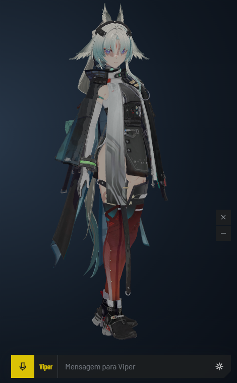
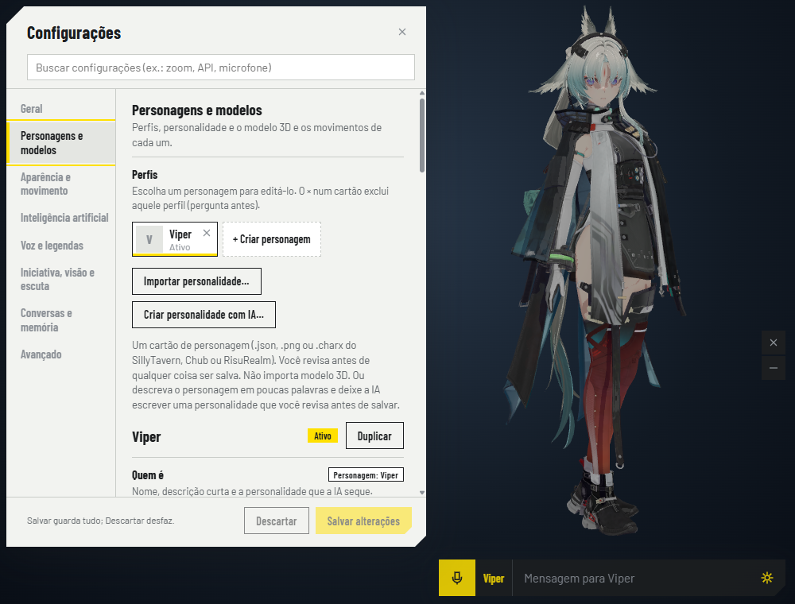
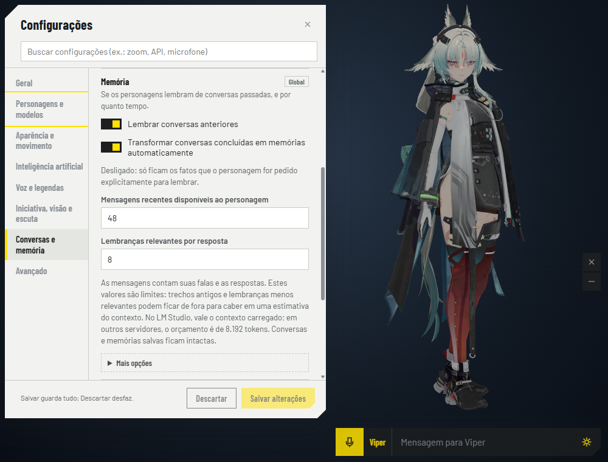
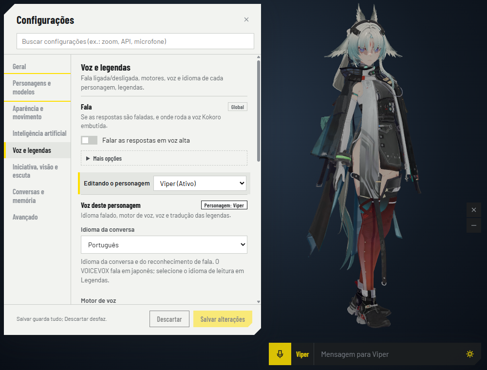
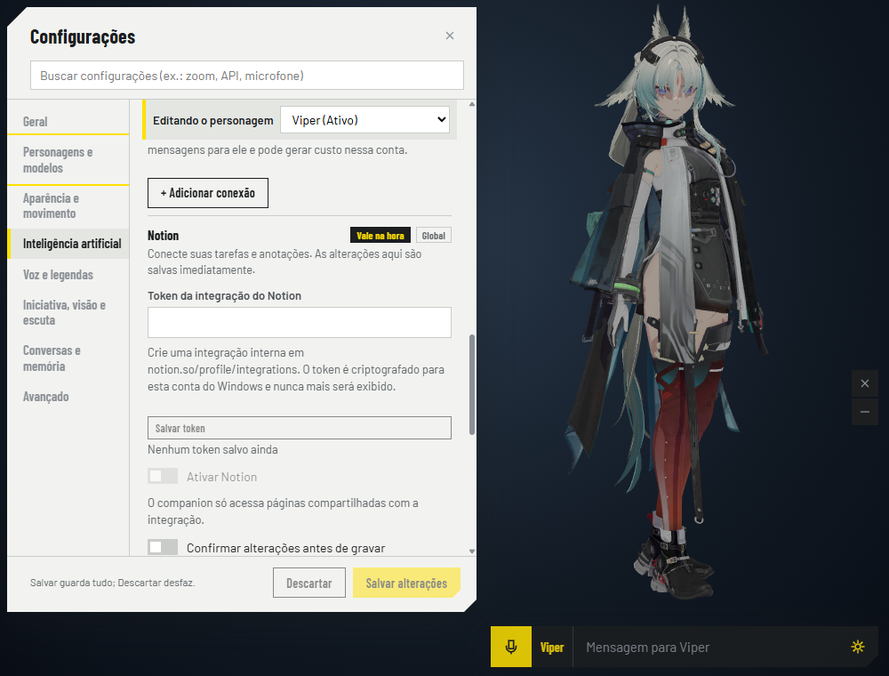

# My Companion

Um companheiro de desktop com avatar 3D, conversas com IA, voz, legendas traduzidas e memória entre conversas. Use o LM Studio para conversar com um modelo local ou configure um dos serviços compatíveis.

**[Baixar o instalador para Windows x64](https://github.com/metralhadora12-cmd/my-companion-releases/releases/latest)**

## Conheça o aplicativo

  

O avatar acompanha a conversa na área de trabalho. A barra reúne mensagens e acesso às ferramentas; as legendas podem aparecer em português mesmo com a voz configurada em japonês.

### Personagens e personalidades

Crie perfis com personalidade, modelo 3D e voz próprios. Importe cartões de personagem ou gere uma personalidade editável com a IA configurada.

### Memória de conversas

Ajuste quantas mensagens recentes e lembranças relevantes entram em cada resposta, dentro do contexto disponível no modelo.

### Voz e legendas

Configure o idioma da conversa, o motor de voz e o idioma das legendas por personagem.

### Integração com Notion

Leia e pesquise informações, salve anotações e tarefas e crie páginas nos destinos compartilhados com a integração.

## Sobre as imagens

Capturas reais da versão 0.1.3 em um perfil de demonstração separado. O fundo foi definido para apresentação. Nenhuma conversa pessoal ou credencial aparece nas imagens. O modelo 3D exibido é um recurso fornecido pelo usuário e não acompanha o instalador.

Este repositório distribui os instaladores e arquivos de atualização do My Companion. O código-fonte é privado.
